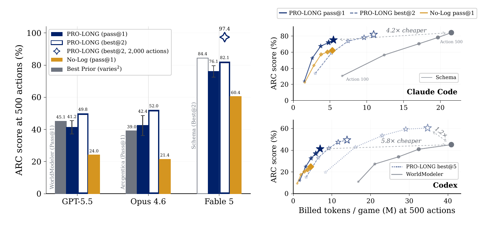

# PRO-LONG

**Programmatic memory for long-horizon agents!** PRO-LONG is a minimal memory addition for LLM agents on long-horizon tasks that keeps a complete interaction log outside the accessed context window; the agent searches this log programmatically when it needs earlier history. Our harness achieves 97.4% best@2 on ARC-AGI-3 at a total cost of $1,750.

[Coding Agent Memory](#tool-guide) · [Research](#research) · [Paper](https://arxiv.org/abs/2607.20064)

## Coding Agent Memory Tool

We find that PRO-LONG works beyond ARC-AGI-3 and NetHack, and can aid standard coding agent usage. 
Add local, persistent, and searchable memory (i.e., PRO-LONG) to **Codex, Claude Code, OpenCode, or pi**. PRO-LONG
records session events in `.prolong/log.jsonl` and installs a retrieval skill so
the agent can recover relevant history after compaction or across sessions.

### Quick start

```bash
git clone https://github.com/alexisfox7/PRO-LONG.git
cd PRO-LONG
npm ci && npm run build && npm link

cd /path/to/your/project
prolong init
```

Requires Node.js 20 or later. Then use your coding agent normally; it searches
the log with tools such as `rg`, `jq`, or Python when prior context is needed.

### Commands

| Command | Purpose |
|---|---|
| `prolong init` | Detect supported clients and configure them for this project. |
| `prolong status` | Check the installation; add `--json` for machine-readable output. |
| `prolong uninstall` | Remove integrations and preserve the log. |
| `prolong uninstall --purge` | Remove integrations and delete the recorded history. |

To choose clients explicitly:

```bash
prolong init --client codex,claude-code,opencode,pi
```

### Client support

| Client | Project integration |
|---|---|
| Codex | `.codex/hooks.json` |
| Claude Code | `.claude/settings.json` |
| OpenCode | `.opencode/plugins/prolong.ts` |
| pi | `.pi/extensions/prolong.ts` |

Hooks and extensions run with your user permissions. Review the integration and
accept the client's project or hook trust prompt before use.

<details>
<summary>Installed files and privacy</summary>

- `.prolong/`: recording code, installation record, and history log.
- `.agents/skills/prolong/`: instructions for searching the log.
- `AGENTS.md`: a note pointing to the log; Claude Code also receives `CLAUDE.md`.
- Client files listed above and a `.prolong/` entry in `.gitignore`.

The log is local and gitignored by default. It can contain prompts, tool inputs,
outputs, and secrets that appeared in a session. Only enable it in projects where you can keep this history on disk.

</details>

## Research

The research harness records every observation, action, and outcome in one log. The agent reads and searches it using its coding tools. There are no subagents or specialized retrieval mechanisms, and the core prompt is about 30 lines.

The paper evaluates this approach on ARC-AGI-3 and NetHack:

- **ARC-AGI-3:** an average **+18.0 percentage points** over matched coding agents
  without the log, across GPT-5.5, Opus 4.6, and Fable 5 at 500 actions per game.
- **Extended action budget:** **97.4% best@2** with Fable 5 at 2,000 actions per
  game, for a total cost of **\$1,750**.
- **NetHack:** up to **2.2× higher mean best-of-five progression** than the no-log
  baseline when memory is retained across episodes.



*Figure 2 from the paper. Filled bars show pass@1; outlined bars show best@2.
Comparisons use 500 actions per game, except the 97.4% diamond at 2,000 actions.
See the paper for scoring and token-accounting details.*

See [research results](research/README.md) or [run the ARC-AGI-3 harness](research/arc-agi-3/README.md).

[Read the paper](https://arxiv.org/abs/2607.20064) · [Citation](CITATION.cff) · [MIT license](LICENSE)
