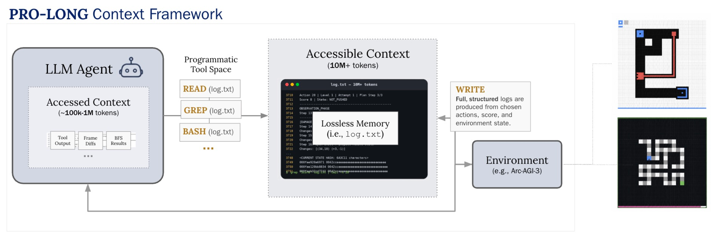
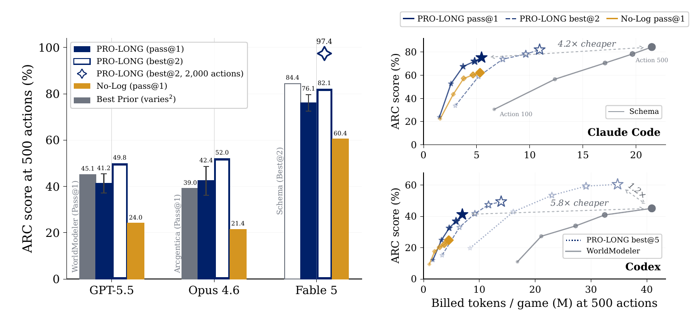
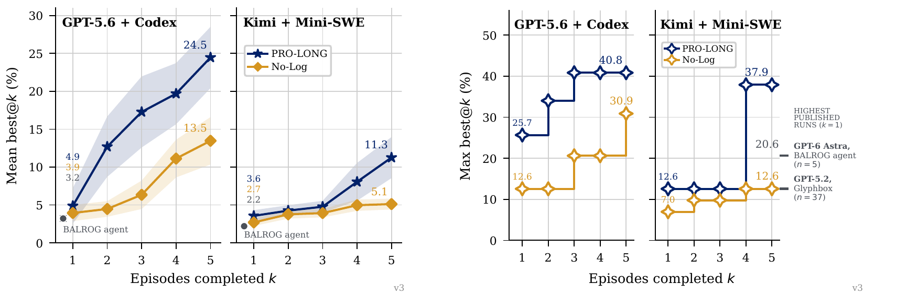

# PRO-LONG Results!

**Programmatic Memory Enables Long-Horizon Reasoning**

Our paper evaluates PRO-LONG on ARC-AGI-3 and NetHack, and this directory contains the ARC-AGI-3 harness, scorecards, and the experiment logs of our 97.4% Fable 5 runs.

[Paper](https://arxiv.org/abs/2607.20064) · [Method](#method) · [Results](#results) · [Reproduction](#reproduction) · [Code and logs](#code-and-logs)

For our coding agent memory tool, see the [tool guide](../README.md#tool-guide).

## Method

The harness appends observations, actions, and outcomes to a log without summarizing them. The agent uses file reads, grep, and Python to inspect earlier states and actions without loading the full history into context.



The ARC-AGI-3 implementation wraps Codex or Claude Code in a Docker sandbox.
The agent writes an action batch to `actions.json`; the host executes it,
records the resulting boards, and requests another plan when needed. Each game
has a separate workspace and session. The core prompt is about 30 lines, with
no subagents or specialized retrieval system. The `prolong-swarm` command runs
independent games concurrently; it does not coordinate multiple agents within
a game.

The **no-log** baseline retains the same coding tools and can write its own notes.
It receives the current board in the prompt but has no harness-maintained
history file.

## Results

Results and experimental details are in the [paper](https://arxiv.org/abs/2607.20064).

### ARC-AGI-3

The main comparison covers all **25 public games**, with **500 actions per game**
and batches of at most 20 actions. Scores use Relative Human Action Efficiency
(RHAE), which accounts for level completion and action efficiency. Pass@1 averages benchmark scores over independent runs; best@k selects the best result per game across k runs.

| Model | No-log pass@1 | PRO-LONG pass@1 | Gain |
|---|---:|---:|---:|
| GPT-5.5 | 24.0% | **41.2%** | +17.2 pp |
| Opus 4.6 | 21.4% | **42.4%** | +21.0 pp |
| Fable 5 | 60.4% | **76.1%** | +15.7 pp |

The average improvement is **18.0 percentage points**. With GPT-5.5, PRO-LONG
reaches **60.1% best@5** at the same per-run action budget.



*Paper, Figure 2. Filled bars show pass@1 and outlined bars show best@2; the
right-hand panels compare score with billed tokens. The 97.4% diamond uses a
larger, 2,000-action budget.*

**Extended action budget.** With Fable 5 at 2,000 actions per game, PRO-LONG
reaches **94.6% pass@1** for \$1,500 and **97.4% best@2** for \$1,750 total.

### NetHack

In NetHack, a lifetime contains five sequential episodes on a fixed seed, each with up to
20,000 environment actions; PRO-LONG retains its history across episodes.

| Model and agent | Lifetimes per condition | No-log mean best@5 | PRO-LONG mean best@5 |
|---|---:|---:|---:|
| GPT-5.6 + Codex | 10 | 13.5% | **24.5%** |
| Kimi + Mini-SWE | 15 | 5.1% | **11.3%** |

Mean best@5 is the best BALROG progression score within each five-episode
lifetime, averaged over lifetimes. The gains are approximately 1.8× and 2.2×,
respectively. The best individual episode observed within any lifetime reaches
**40.8%** with GPT-5.6 and **37.9%** with Kimi.



*Paper, Figure 5. Left: mean best@k progression with standard errors across
lifetimes. Right: the highest episode score observed through episode k across
all lifetimes.*

### Ablations

| Tools available to GPT-5.5 | ARC-AGI-3 pass@1 |
|---|---:|
| Read only | 23.1% |
| + grep / regular-expression search | 27.2% |
| + Python | 38.3% |
| + write and edit | 41.2% |

*Paper, Table 2; each row adds to the preceding tool set.*

Clearing the agent's workspace between calls has little effect on PRO-LONG
(41.2% to 40.7%) but reduces no-log from 24.0% to 19.9% (Table 3).
Reducing Codex's compaction threshold from 244K to 64K also preserves PRO-LONG's
performance within reported uncertainty (41.2% versus 44.3%; Figure 4).

## Reproduction

See the [ARC-AGI-3 README](arc-agi-3/README.md) for setup, commands, and memory conditions.

## Code and logs

| Location | Contents |
|---|---|
| [ARC-AGI-3 guide](arc-agi-3/README.md) | Setup, commands, configuration, and output reference |
| `arc-agi-3/prolong_agent/` | Agent backends, game loop, action queue, and reporting |
| `arc-agi-3/docker/` | Sandbox and model-API proxy images |
| [Scorecards](arc-agi-3/scorecards/) | Official online scorecard links, including 25 Fable 5 runs |
| [Released trajectories](https://github.com/alexisfox7/PRO-LONG/tree/main/research/arc-agi-3/release_logs) | Fable 5 game logs, agent transcripts, scorecards, and saved workspaces |

## Citation

```bibtex
@misc{fox2026prolong,
  title={PRO-LONG: Programmatic Memory Enables Long-Horizon Reasoning},
  author={Fox, Alexis and Wang, Junlin and Rosu, Paul and Dhingra, Bhuwan},
  year={2026},
  eprint={2607.20064},
  archivePrefix={arXiv},
  primaryClass={cs.AI},
  url={https://arxiv.org/abs/2607.20064},
}
```

See also [CITATION.cff](../CITATION.cff). The original Read-Grep-Bash (RGB) agent
is described in the [earlier blog post](https://blog.alexisfox.dev/arcagi3).
