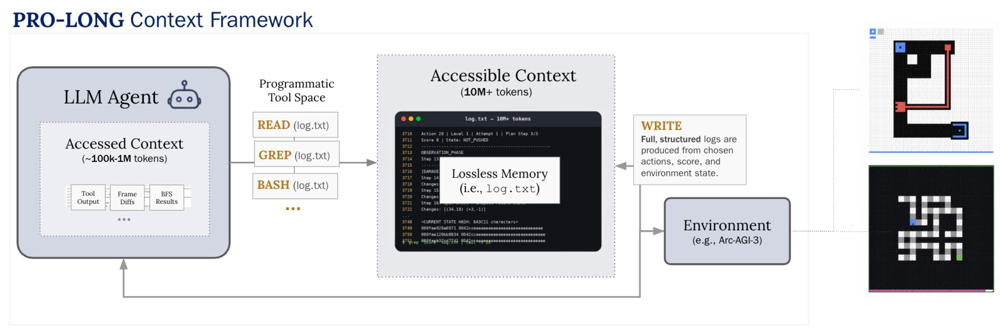
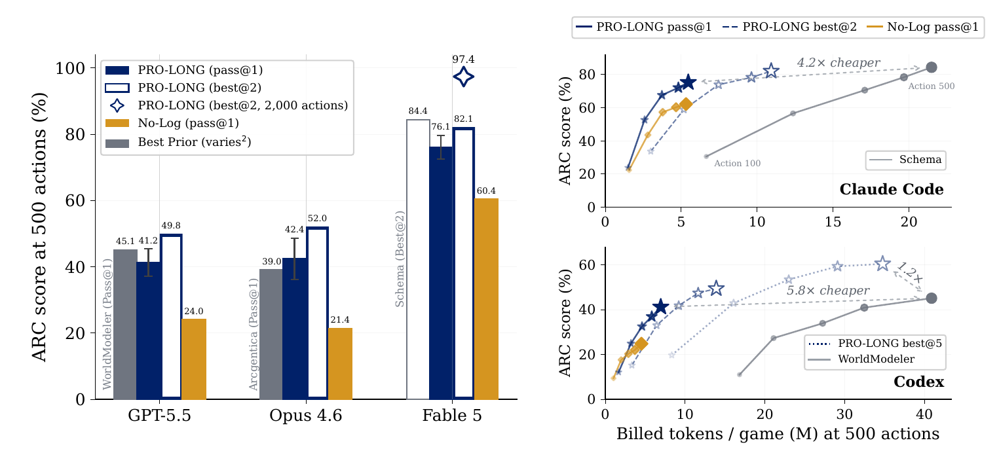
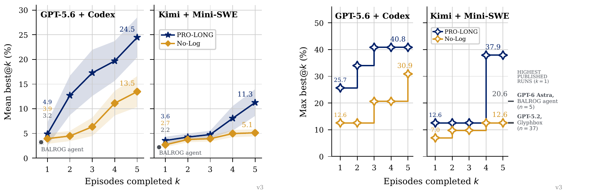

# PRO-LONG research

**Programmatic Memory Enables Long-Horizon Reasoning**

PRO-LONG gives a coding agent a complete, structured interaction history and
lets it retrieve relevant evidence with code. The paper studies this approach
on ARC-AGI-3 and NetHack. This repository currently releases the ARC-AGI-3 harness,
scorecards, and a subset of the experiment logs.

[Paper](https://arxiv.org/abs/2607.20064) · [Method](#method) · [Results](#results) · [Reproduction](#reproduction) · [Released artifacts](#released-artifacts)

For the coding-agent memory tool, see the [tool guide](../README.md#tool-guide).

## Method

Long trajectories can exceed an agent's active context window. PRO-LONG keeps
the full history accessible on disk while allowing the agent to bring only the
relevant parts into context.

- **Write:** the harness appends observations, actions, and outcomes to a
  structured log, without summarizing away environment history.
- **Read:** the agent searches that log using file reads, regular expressions,
  shell commands, and Python. It can compare distant states, replay past actions,
  or test a hypothesis against the recorded trajectory.



The ARC-AGI-3 implementation wraps Codex or Claude Code in a Docker sandbox.
The agent writes an action batch to `actions.json`; the host executes it,
records the resulting boards, and requests another plan when needed. Each game
has a separate workspace and session. The core prompt is about 30 lines, with
no subagents or specialized retrieval system. The `prolong-swarm` command runs
independent games concurrently; it does not coordinate multiple agents within
a game.

The **no-log** baseline retains the same coding tools and can write its own notes.
It receives the current board in the prompt but has no harness-maintained
history file. This isolates the benefit of programmatic memory from the benefit
of coding tools themselves.

## Results

The numbers and figures below are reported in the paper. They evaluate the
research harness, rather than the project-local coding-tool integrations.

### ARC-AGI-3

The main comparison covers all **25 public games**, with **500 actions per game**
and batches of at most 20 actions. Scores use Relative Human Action Efficiency
(RHAE), which accounts for level completion and action efficiency. Here,
**pass@1 is the mean benchmark score over independent runs**, not the percentage
of games fully solved; best@k selects the best result per game across k runs.

| Model | No-log pass@1 | PRO-LONG pass@1 | Gain |
|---|---:|---:|---:|
| GPT-5.5 | 24.0% | **41.2%** | +17.2 pp |
| Opus 4.6 | 21.4% | **42.4%** | +21.0 pp |
| Fable 5 | 60.4% | **76.1%** | +15.7 pp |

The average improvement is **18.0 percentage points**. With GPT-5.5, PRO-LONG
reaches **60.1% best@5** at the same per-run action budget.



*Paper, Figure 2. Filled bars show pass@1 and outlined bars show best@2; the
right-hand panels compare score with billed tokens. The 97.4% diamond uses a
larger, 2,000-action budget. Confidence intervals are shown where repeated runs
are available.*

**Token efficiency.** At 500 actions, GPT-5.5 + PRO-LONG scores 41.2% versus
WorldModeler's 45.1%, using 5.8× fewer billed tokens. The Claude comparison is
82.1% best@2 versus Schema's 84.4%, at 4.2× fewer billed tokens when comparing
retained runs. Counting both PRO-LONG runs against Schema's released retained
runs still gives a 2.0× token reduction. These comparisons use the paper's
rescoring and accounting conventions (Section 3.1).

**Extended action budget.** With Fable 5 at 2,000 actions per game, PRO-LONG
reaches **94.6% pass@1** for $1,500 and **97.4% best@2** for $1,750 total.
The best@2 score is a lower bound because some games were not rerun. These
results are separate from the 500-action comparison above.

### NetHack

NetHack tests memory across much longer trajectories and repeated failures.
A lifetime contains five sequential episodes on a fixed seed, each with up to
20,000 environment actions; PRO-LONG retains its history across episodes.

| Model and agent | Lifetimes per condition | No-log mean best@5 | PRO-LONG mean best@5 |
|---|---:|---:|---:|
| GPT-5.6 + Codex | 10 | 13.5% | **24.5%** |
| Kimi + Mini-SWE | 15 | 5.1% | **11.3%** |

Mean best@5 is the best BALROG progression score within each five-episode
lifetime, averaged over lifetimes. The gains are approximately 1.8× and 2.2×,
respectively. The best individual episode observed within any lifetime reaches
**40.8%** with GPT-5.6 and **37.9%** with Kimi.



*Paper, Figure 5. Left: mean best@k progression with standard errors across
lifetimes. Right: the highest episode score observed through episode k across
all lifetimes. These maxima are distinct from the averages in the table.*

NetHack results are included here for the full research picture; its evaluation
code and trajectories are not included in this release.

### What drives the gains?

The paper's ablations separate programmatic access from other forms of memory:

| Tools available to GPT-5.5 | ARC-AGI-3 pass@1 |
|---|---:|
| Read only | 23.1% |
| + grep / regular-expression search | 27.2% |
| + Python | 38.3% |
| + write and edit | 41.2% |

*Paper, Table 2; each row adds to the preceding tool set.*

Clearing the agent's workspace between calls has little effect on PRO-LONG
(41.2% to 40.7%) but reduces no-log from 24.0% to 19.9% (Table 3).
Reducing Codex's compaction threshold from 244K to 64K also preserves PRO-LONG's
performance within reported uncertainty (41.2% versus 44.3%; Figure 4).
Together, these experiments support keeping more history accessible on disk
while retrieving a small amount into active context.

## Reproduction

Start with the [ARC-AGI-3 setup and evaluation guide](arc-agi-3/README.md).
It covers Python and Docker installation, authentication, single-game runs,
full-suite evaluation, memory conditions, CLI flags, and output files.

The released harness supports three memory conditions:

| Condition | CLI setting | History supplied by the harness |
|---|---|---|
| PRO-LONG | Omit `--log-window` | Complete game history |
| Truncated history | `--log-window 25` | Last 25 action sections |
| No-log | `--log-window -1` | Current board in the prompt; no history file |

For comparable experiments, hold the model, reasoning effort, game versions,
action budget, batch size, and board encoding fixed while varying memory.
Run independent repetitions for pass@1 and best@k: one `prolong-swarm` invocation
performs one run per selected game, not an automatic best-of-k evaluation.
The release does not include a script that regenerates every paper figure or
aggregates repeated runs into best@k.

The paper uses high reasoning effort unless stated otherwise. The released
CLI defaults to `none` for Codex and `high` for Claude Code, so set effort
explicitly when reproducing those comparisons. The Dockerfiles install
unpinned coding-agent CLIs; record their versions and image IDs alongside
the repository revision, model, command, and Python environment.

## Released artifacts

| Location | Contents |
|---|---|
| [ARC-AGI-3 guide](arc-agi-3/README.md) | Setup, commands, configuration, and output reference |
| `arc-agi-3/prolong_agent/` | Agent backends, game loop, action queue, and reporting |
| `arc-agi-3/docker/` | Sandbox and model-API proxy images |
| [Scorecards](arc-agi-3/scorecards/) | Official online scorecard links, including 25 Fable 5 runs |
| [Released trajectories](https://github.com/alexisfox7/PRO-LONG/tree/main/research/arc-agi-3/release_logs) | Fable 5 game logs, agent transcripts, scorecards, and saved workspaces |

The released Fable scorecard list contains one run per game; it is not a
complete collection of all repeats used for the paper's best@2 result.
NetHack, Mini-SWE, and the full set of ablation artifacts are not included in
the current repository. The paper documents their experimental settings.

## Citation

```bibtex
@misc{fox2026prolong,
  title={PRO-LONG: Programmatic Memory Enables Long-Horizon Reasoning},
  author={Fox, Alexis and Wang, Junlin and Rosu, Paul and Dhingra, Bhuwan},
  year={2026},
  eprint={2607.20064},
  archivePrefix={arXiv},
  primaryClass={cs.AI},
  url={https://arxiv.org/abs/2607.20064},
}
```

See also [CITATION.cff](../CITATION.cff). The original Read-Grep-Bash (RGB) agent
is described in the [earlier blog post](https://blog.alexisfox.dev/arcagi3).
